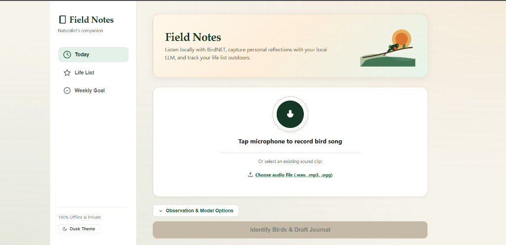

# 🌿 Field Notes: Offline-First Birding Companion

> 🎃 **Hacktoberfest Open Source Contribution**: Field Notes is an open-source project created for the **DEV Hacktoberfest "Touch Grass" challenge**. It demonstrates open-source AI at the core—running 100% offline and locally without cloud dependencies to encourage people to explore nature outdoors. Community contributions, new feature suggestions, and outdoor field tests are warmly welcomed!

Field Notes is an offline-first birding companion built for the DEV Hacktoberfest **Touch Grass** challenge. It uses open-source AI locally to minimize screen time outdoors: record or upload a bird call, identify the species locally with BirdNET, let a local LLM write a brief field-journal entry, and log new sightings to your personal life list and weekly goal tracker.

Built with a fast, lightweight **FastAPI** backend and a naturalist-styled, zero-dependency **single-page frontend** (`static/index.html`).

---

## Features

- **Local Acoustic Detection**: Identifies bird calls locally with BirdNET without external cloud APIs.
- **AI Field Journaling**: Local LLM (via Ollama) drafts warm, 4–6 sentence field observations, fun facts, and tips to listen for next time.
- **Naturalist Paper UI**: Responsive, tactile field journal interface designed with warm paper textures, deep forest greens, moss tones, and high contrast for outdoor sunlight readability.
- **Life List & Weekly Tracker**: Automatically checks for first-time sightings, adds them to your local SQLite life list, and tracks your progress toward a weekly discovery goal.
- **Markdown Export**: Download your field notes for your personal journal or blog with one click.
- **Offline & Private**: Runs 100% locally on your machine with zero external CDN dependencies, zero API keys, and zero tracking.

---

## Why Open Source?

- **100% Offline Resilience**: Nature is often out of range of cellular data and Wi-Fi. Field Notes runs completely on your machine in the field.
- **Privacy First**: Your audio recordings, personal locations, and coordinates stay strictly on your local disk.
- **Swappable Models**: Change your local LLM anytime (`llama3.2:3b`, `qwen2.5:3b`, `gemma3:4b`, etc.) without rewriting code or paying per-token API fees.
- **Zero Cost**: Built entirely with free, permissive open-source tools: Python, BirdNET, Ollama, SQLite, and FastAPI.

---

## Getting Started

### 1. Prerequisites
- Python 3.10+
- [Ollama](https://ollama.com/) installed and running locally

### 2. Pull a Local LLM
Ensure your Ollama service is active, then pull a lightweight model:
```bash
ollama pull llama3.2:3b
```
*(Alternatively, pull `qwen2.5:3b` or `gemma:2b`).*

### 3. Setup Virtual Environment
```bash
python -m venv .venv

# On Windows:
.\.venv\Scripts\activate

# On Linux / macOS:
source .venv/bin/activate

pip install -r requirements.txt
```

---

## Running Field Notes

Start the FastAPI application with Uvicorn:
```bash
uvicorn main:app --host 0.0.0.0 --port 8000 --reload
```

Open your browser to:
👉 **[http://localhost:8000](http://localhost:8000)**

### Accessing from a Phone on the Same Wi-Fi
To use Field Notes outdoors or in your garden on your mobile phone:
1. Find your computer's local IP address (e.g. `192.168.1.X` via `ipconfig` on Windows or `ifconfig` / `ip a` on Linux/macOS).
2. Start the server bound to all interfaces:
   ```bash
   uvicorn main:app --host 0.0.0.0 --port 8000
   ```
3. On your phone connected to the same Wi-Fi, open `http://<your-computer-ip>:8000`.

> **Note on Microphone Access**: Mobile and desktop browsers restrict browser-based live microphone recording (`MediaRecorder` via `navigator.mediaDevices.getUserMedia`) to secure contexts (`localhost` or `HTTPS`). When accessing the app over local Wi-Fi via HTTP IP, use the built-in **"Choose audio file"** button, which activates the phone's native audio recorder and microphone capture via `<input type="file" accept="audio/*" capture="environment">`.

---

## Testing Audio Clips

### CLI Audio Check
You can test audio clips directly from the terminal without opening the browser:
```bash
python -m fieldnotes.detector samples/synthetic_chirp.wav
```

### Generating Test Samples
Generate offline synthetic bird chirps for testing:
```bash
python scripts/make_sample.py
```

### Real Audio Clips (xeno-canto)
To test with real bird audio in the field or at home, you can download freely licensed audio clips (e.g. Creative Commons BY-NC-SA or CC-BY) from [xeno-canto.org](https://xeno-canto.org), for example:
- **American Robin** (*Turdus migratorius*)
- **Black-capped Chickadee** (*Poecile atricapillus*)
- **Northern Cardinal** (*Cardinalis cardinalis*)
Place downloaded `.wav` or `.mp3` files in the `samples/` directory and attribute the recordist per their CC license.

---

## Running Automated Tests

Run the complete test suite with pytest:
```bash
pytest -v
```

---

## Screenshots



---

## Outdoor Test Results

Fill this table with your real-world field observation tests:

| Date | Location | Audio Clip / Duration | Species Detected | Correct (Y/N) | False Positives | Notes |
| :--- | :--- | :--- | :--- | :--- | :--- | :--- |
| | | | | | | |
| | | | | | | |
| | | | | | | |
| | | | | | | |
